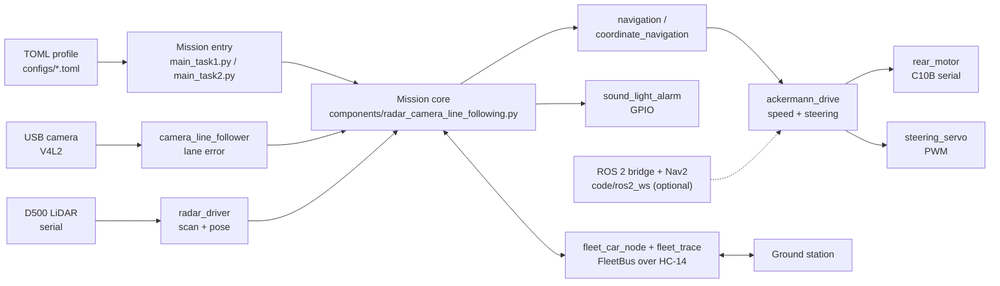
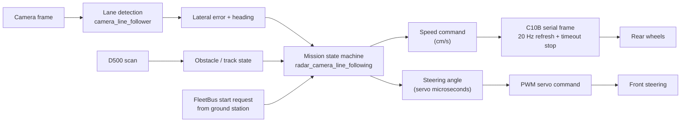

# System Architecture — Ackermann Ground Robot

> **Scope**: high-level software architecture of the Ackermann ground robot in this
> repository, derived from source code at `main` = `e244cd7805a6682c64ec2287b52e3a1a66fa70b4`
> (2026-10-11). Hardware behaviour described here is **not** a claim of on-vehicle
> verification; see [Validation](#7-validation-and-limitations) for what is and is
> not established.

## 1. Purpose and boundary

This repository is the on-vehicle computer stack for a four-wheel Ackermann vehicle
with a ROCK 5A-class host, a C10B rear-motor controller, a front steering servo, a
D500 single-line LiDAR, a V4L2 camera and an HC-14 half-duplex radio link to the
ground station. It implements the two competition missions (`D-task 1` and
`D-task 2`) plus shared, reusable components.

Out of scope for this document: mission rules, field geometry values, and any
performance numbers that are not backed by a log in this repository.

## 2. Diagram A — system panorama

Solid arrows are the default production path; the dotted ROS 2 path is an optional
integration and is not required by `main_task1.py` / `main_task2.py`.

## 3. Diagram B — mission data flow (camera lane following + LiDAR gating)

## 4. Component evidence

| Component | Role | Input / output | Evidence (path @ commit) | Status |
|---|---|---|---|---|
| `code/main_task1.py`, `code/main_task2.py` | Mission entries; load TOML profile and delegate to shared core | CLI/TOML → `run_mission(task, argv)` | `code/main_task1.py`, `code/main_task2.py` @ `e244cd78` | production entry |
| `code/components/radar_camera_line_following.py` | Shared mission loop: sensor reads, state machine, actuator commands, logging | camera + LiDAR + FleetBus → motor/servo/alarm | same @ `e244cd78` | production core |
| `code/components/camera_line_follower.py` | Lane/line error extraction from camera frames | BGR frame → lateral error | same @ `e244cd78` | production |
| `code/components/radar_driver.py` | D500 scan parsing and pose support | serial bytes → scan points | same @ `e244cd78` | production |
| `code/components/navigation.py`, `coordinate_navigation.py` | Waypoint / coordinate navigation over the field frame | pose + goal → speed/heading | same @ `e244cd78` | production |
| `code/components/ackermann_drive.py` | Unifies speed and steering; couples rear differential | speed + angle → motor + servo | same @ `e244cd78` | production |
| `code/components/rear_motor.py` | C10B serial protocol, 20 Hz refresh, timeout stop | speed → serial frame | same @ `e244cd78` | production |
| `code/components/steering_servo.py` | Steering calibration curve (center, range, direction) | angle → PWM microseconds | same @ `e244cd78` | production |
| `code/components/fleet_car_node.py`, `fleet_trace.py` | FleetBus node and trace publishing to the ground station | mission state ↔ HC-14 frames | same @ `e244cd78` | production |
| `code/components/sound_light_alarm.py` | Buzzer / light cues on GPIO | event → GPIO | same @ `e244cd78` | production |
| `code/hal/gpio.py`, `code/hal/pwm.py` | Hardware abstraction for GPIO/PWM | logical pin → sysfs/chardev | same @ `e244cd78` | production |
| `code/ros2_ws/src/car_ros_bridge/*`, `car_nav_bringup/*` | Optional ROS 2 bridge, D500 localization, Nav2 bringup | ROS topics/actions ↔ base | same @ `e244cd78` | optional |
| `configs/cooper_rock5a_l150.toml` | Current vehicle profile (geometry, devices, speeds) | — | same @ `e244cd78` | reference config |

## 5. Runtime modes

- **Production missions** — `python3 code/main_task1.py --config configs/<profile>.toml`
  and `code/main_task2.py`. The TOML profile selects devices, speeds and mission
  parameters; CLI flags override profile values.
- **Other-school porting** — copy `configs/car.example.toml`, edit geometry/devices,
  then calibrate steering and camera as described in `docs/CALIBRATION.md`.
- **ROS 2 / Nav2** — optional; see `docs/ROS2_NAV2_INTEGRATION.md`. It is a separate
  bridge, not a dependency of the two mission entries.

## 6. Safety-relevant behaviour found in code

- `rear_motor.py` refreshes the C10B command at 20 Hz and stops on timeout.
- `ackermann_drive.py` owns the shared hardware lock (`DEFAULT_HARDWARE_LOCK_PATH`)
  so two processes cannot drive the base simultaneously.
- `steering_servo.py` validates angles against the calibrated travel
  (`steering_angle_to_pulse_us` raises `ValueError` beyond the range) instead of
  sending an out-of-range pulse.

These are code-level behaviours. They are **not** a substitute for an on-vehicle
emergency-stop procedure.

## 7. Validation and limitations

- Entry points, component boundaries and configuration keys in this document were
  read from source; no claim is made that a specific competition run succeeded.
- The repository has **no root LICENSE**; third-party and licensing status is
  tracked separately (see the repository audit reports for this account).
- Hardware measurements (wheelbase, track width, servo center) are configuration
  values, not universally valid constants.
- The ECDC variant of this project lives on the `competition/ecdc-2026` branch and
  is **not** the default `main` described here.

## 8. Where to go next

- Configuration: `docs/CONFIGURATION.md`
- Steering / camera calibration: `docs/CALIBRATION.md`, `docs/FIELD_CALIBRATION.md`
- Hardware commissioning and porting: `docs/HARDWARE_COMMISSIONING.md`, `docs/HARDWARE_PORTING.md`
- ROCK 5A wiring: `docs/platforms/rock5a.md`
- ROS 2 bridge: `docs/ROS2_NAV2_INTEGRATION.md`
